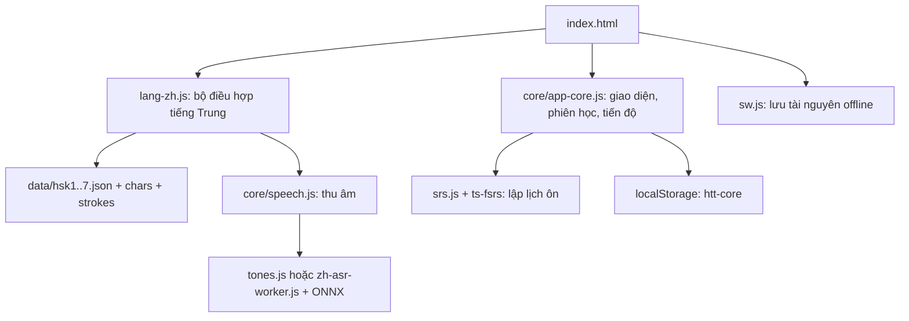

# Khảo sát dự án và chuẩn bị dữ liệu HSK 1–9

Ngày khảo sát: **26/10/2026**, múi giờ Asia/Saigon. Kho mã: [meiiie/hoc-tieng-trung](https://github.com/meiiie/hoc-tieng-trung), nhánh `main`, commit nền `c9336d6ca1cc17fde1f7d9e6eee728847f87ffa5`.

## Kết luận để bắt đầu công việc

Dự án **đã chứa 10.969 mục từ** trong bảy tệp `data/hsk1.json` đến `hsk7.json`; HSK 7–9 là một nhóm chung. Đã tải lại cả bảy danh sách nguồn tại commit `7ac65bf` của complete-hsk-vocabulary và đối chiếu: ID và thứ tự của mọi cấp đều khớp, không thiếu mục so với nguồn đã chọn.

Tuy nhiên, điều đó **không chứng minh đã đủ đề cương HSK mới**. PDF đề cương do trang Chinese Tests Service Website liên kết, phát hành 11/2025 và ghi áp dụng 07/2026 trên bìa, có **11.000 mục**, phân cấp khác bộ hiện tại. Đây là đối chiếu tài liệu; không suy diễn rằng mọi điểm thi đã chuyển phiên bản vào cùng một ngày.

Lượt này hoàn thành phần clone, khảo sát, kiểm kê và chuẩn bị danh sách đối chiếu. Chưa nhập từ, dịch hàng loạt, đổi ID, đổi cấp hay sửa thuật toán học. Những thay đổi phục vụ làm việc local gồm công cụ kiểm kê, công cụ so sánh PDF, server có MIME đúng trên Windows, đường dẫn Chromium linh hoạt trong hai bài kiểm tra và tài liệu này.

## 1. Sản phẩm và kiến trúc thực tế

Đây là **PWA tĩnh bằng JavaScript thuần**, giao diện tiếng Việt, phục vụ được trên GitHub Pages. Không có React/Vue, backend ứng dụng, cơ sở dữ liệu máy chủ hay bước bundle bắt buộc. Dữ liệu học nằm trên thiết bị; không thấy luồng tài khoản hoặc đồng bộ đa thiết bị trong mã hiện tại.



| Thành phần | Vai trò và điểm cần giữ khi mở rộng |
|---|---|
| `index.html`, `core/style.css`, `lang-zh.css`, `core/mascot.js` | Khung trang, phong cách Neko, mascot, giao diện mobile và desktop. Script được nạp theo thứ tự, không qua bundler. |
| `core/app-core.js` | Router theo hash, lọc bộ từ, flashcard, học, kiểm tra, lịch ôn, thống kê, sao lưu, cài đặt. Có các nhánh dành cho tiếng Anh nhưng adapter tiếng Trung thay hành vi liên quan. |
| `lang-zh.js` | HSK, mở khóa cấp, chữ giản/phồn thể, pinyin, đáp án, tìm kiếm, Hán Việt, nghe/nói/viết. Kết nối core qua `window.LANG`. |
| `srs.js`, `vendor/ts-fsrs.min.js` | FSRS-6, SM-2 tùy chọn, bước học ngắn, lịch ngày, phân tải và thẻ hay quên. |
| `tools/make-core.py` | Sinh core từ app tiếng Anh v17 bằng các phép thay chuỗi có assertion. Sửa trực tiếp core có thể bị mất khi sinh lại; thay đổi chung phải xét cả bộ sinh. |
| `tools/build-data.py` | Chuyển danh sách HSK, CC-CEDICT/CVDICT, Unihan và Kai Hanzi thành dữ liệu chạy. Nhận ba đường dẫn đầu vào và cần biến môi trường `CVDICT`, `UNIHAN`. |
| `audio/`, `data/strokes/` | Audio thu sẵn HSK 1–3, dữ liệu nét chữ theo từng ký tự. |
| `models/`, `zh-asr-worker.js`, `vendor/ort/` | Mô hình âm tiết/thanh điệu chạy trên thiết bị, tải theo yêu cầu. |
| `sw.js` | App shell `htt-v4`; dữ liệu `htt-data-v3`; audio `htt-audio-v1`; mô hình `htt-engine-v1`. |

Adapter chỉ tải các cấp đã mở. Mới vào mặc định là HSK 1; cấp bị khóa không nằm trong `words`, tìm kiếm và thống kê của phiên hiện tại. Vì vậy, thấy ít từ trong giao diện không đồng nghĩa dữ liệu các cấp sau chưa tồn tại. `ensureLevel()` tải thêm cấp khi mở khóa; `WMAP` phục vụ tra ID.

## 2. Thuật toán học của Meiiie trong mã hiện tại

### Lịch ôn dài hạn

`srs.js` dùng **ts-fsrs 5.4.2 / FSRS-6** với trọng số mặc định của thư viện. Mỗi thẻ giữ trạng thái, hạn ôn, lần ôn cuối, số lần ôn/quên, stability `s` và difficulty `d`. Chưa thấy bộ tối ưu tự huấn luyện trọng số FSRS từ lịch sử cá nhân.

- Người học chọn **Lại / Khó / Được / Dễ** tương ứng điểm 1–4. “Khó” vẫn có nghĩa là đã nhớ ra; “Lại” là quên.
- Mức ghi nhớ mong muốn mặc định là **90%**, điều chỉnh trong cài đặt. FSRS dùng kết quả đánh giá để cập nhật trí nhớ và khoảng ôn.
- Bước học: **1 phút, 10 phút**; học lại: **10 phút**. Chọn “Dễ” có thể đưa thẻ mới thẳng sang Review, nên “đã qua bước học” không luôn đồng nghĩa đã ôn đúng vào một ngày khác.
- Mốc ngày của scheduler là **04:00 theo giờ thiết bị**. Fuzz tạo độ lệch khoảng ôn; load balancing ưu tiên ngày ít thẻ trong khoảng cho phép. Thẻ hai chiều được giãn cách và tạm ẩn chiều còn lại trong ngày.
- Quên khi đang Review tăng `lapses`; đến **8 lần** thì gắn leech, tạm ngưng và gắn sao. Cảnh báo tiếp theo cách 4 lần nếu được mở lại.
- `gradeCard()` cập nhật `S.srs`, ghi `S.revlog`, nhật ký ngày và trạng thái ẩn thẻ. Có hoàn tác trong phiên.

Hàng đợi thực tế trong `nextCard()` là: **thẻ học đến hạn → thẻ Review đến hạn → thẻ mới trong hạn mức → thẻ học sắp đến hạn trong 20 phút**. Review sắp theo `due` tăng dần, không chia độ trễ cho interval như tài liệu cũ mô tả. Thẻ mới đã có bất kỳ lịch sử luyện tập nào được ưu tiên trước thẻ chưa gặp; trong cùng nhóm giữ thứ tự danh sách.

Mặc định có hai chiều, khóa chiều ngược là `id + '~r'`. Hạn mức mới thực tế tăng theo **thẻ** được giới thiệu, không nhất thiết là số từ độc lập. Onboarding hiện cho chọn 10/25/50/không giới hạn và mặc định chọn không giới hạn; “20 từ/ngày mặc định” trong `docs/LIFECYCLE.md` là mô tả cũ. Nhật ký mục tiêu dùng ngày lịch, trong khi lịch SRS dùng 04:00; cần giữ ý thức về khác biệt này khi kiểm thử gần nửa đêm.

### Luyện tập và trạng thái từ

`practice()` ghi độ quen và lịch sử vào `S.known`, `S.ev`; tiếng Trung đặt `bringForward:false`, nên luyện sai không kéo lịch ôn lên sớm. Luyện nói và viết gọi `evidence()` riêng. Lịch sử luyện tập tối đa 40 bản ghi/từ, lịch sử nói tối đa 20 bản ghi/từ; review log tối đa 20.000 bản ghi.

| Chế độ | Hành vi thực tế |
|---|---|
| Thẻ ghi nhớ | Duyệt tự do; từ “đang học” được đưa lại cuối hàng đợi. Không lập lịch SRS. |
| Học | Chọn nghĩa → tự nhớ/gõ → điền câu → nghe chép; đúng tiến bước, sai lùi bước. Hiện tiếng Trung bỏ qua điền câu vì chưa có ví dụ và `cloze()` trả `null`. Vòng thường 7 từ. |
| Từ khó | Ưu tiên số lần sai luyện tập, quên SRS, leech và gắn sao. Vòng tối đa 12 từ. |
| Nghe – chép | Nghe và nhập chữ Hán hoặc pinyin; ghi kết quả luyện tập. |
| Kiểm tra | Trộn gõ đáp án, trắc nghiệm, đúng/sai; không sửa lịch ôn. |
| Ghép thẻ | Ghép tối đa 6 cặp; sai cộng thời gian. |
| Viết chữ | Hanzi Writer hiển thị nét và quiz; gợi ý sau 3 lần sai, hoàn thành với tối đa 2 lỗi được ghi là đạt. Không tạo thẻ SRS hướng viết. |
| Luyện nói | So âm tiết và thanh điệu trên thiết bị; điểm từ 60 được ghi là đạt luyện tập, không phải chứng nhận phát âm. |

“Đã thuộc” trong `S.learn` là hoàn thành bài luyện. “Thành thạo” trong vòng đời từ là Review có stability ≥21 ngày, hoặc interval ≥21 nếu không có stability. Hai khái niệm này không tương đương; bấm “Đã biết” trên flashcard không tự đưa từ sang Thành thạo.

Đáp án chấp nhận giản thể, phồn thể, pinyin có dấu/không dấu/số; có chuẩn hóa dấu câu và khoảng trắng. Core còn chấp nhận sai lệch chỉnh sửa: chuỗi dài 4–7 ký tự được lệch 1, từ 8 ký tự được lệch 2. Cần xem lại mức khoan dung này khi thêm thành ngữ dài hoặc mục tiêu kiểm tra thanh điệu nghiêm ngặt.

### Mở khóa HSK

HSK kế tiếp mở khi **80% từ ở cấp liền trước** thỏa `state == review`, `state == relearn` hoặc `int >= 1`. Điều kiện dùng thẻ chiều chính; không đòi stability ≥21, không đòi hoàn thành nghe/nói/viết và không loại thẻ đã suspend khỏi phép đếm. Việc mở khóa được lưu lại, không tự thu hồi.

`docs/LIFECYCLE.md` nói có nút “Mở sớm”, nhưng chưa tìm thấy giao diện hoặc handler tương ứng trong bản code này. Cần bổ sung hoặc sửa mô tả ở lượt triển khai, nhất là nếu cần cho người học nâng cao truy cập HSK 4–9 ngay.

### Chấm phát âm

`core/speech.js` thu PCM, cắt im lặng và đưa về mono 16 kHz. Có hai đường:

1. `tones.js`: dò F0 bằng autocorrelation, đổi cao độ sang semitone tương đối, chia âm tiết theo năng lượng gần các vị trí chia đều, phân loại bằng softmax 4 thanh với 12 đặc trưng. Có xử lý biến điệu 3–3, 不 và 一.
2. Mô hình SyllablePredictorV6 INT8 khoảng 30 MB cộng runtime khoảng 14 MB. Worker tạo đặc trưng mel, chạy ONNX/WASM và trả xác suất âm tiết/thanh. Với phần đủ thông tin, điểm kết hợp 60% âm tiết và 40% thanh điệu. Mô hình gộp ü/u và có các âm chưa hỗ trợ; đường fallback vẫn có giới hạn.

Chế độ nói ưu tiên từ có tối đa 4 ký tự. Khi thêm cụm dài, cần kiểm tra phạm vi xuất hiện trong chế độ này. Các con số chính xác trên giọng người/TTS trong `PRONUNCIATION-ZH.md` là kết quả tác giả đã ghi; lượt này kiểm tra hành vi và fixture sẵn có, không lặp lại nghiên cứu trên toàn bộ tập giọng người hay iPhone thật.

## 3. Kiểm kê nội dung đang phát hành

Số liệu dưới đây được tính lại từ tệp, không lấy nguyên từ README.

| Nhóm | Mục từ riêng cấp | Có nghĩa Việt | Thiếu nghĩa Việt | Có Hán Việt |
|---|---:|---:|---:|---:|
| HSK 1 | 506 | 506 | 0 | 505 |
| HSK 2 | 750 | 750 | 0 | 732 |
| HSK 3 | 953 | 953 | 0 | 907 |
| HSK 4 | 972 | 970 | 2 | 860 |
| HSK 5 | 1.059 | 1.056 | 3 | 891 |
| HSK 6 | 1.123 | 1.119 | 4 | 964 |
| HSK 7–9 | 5.606 | 5.579 | 27 | 4.366 |
| Tổng | **10.969** | **10.933** | **36** | **9.225** |

- 10.969 ID duy nhất và 10.969 mặt chữ giản thể duy nhất. Không trùng giữa các tệp hiện tại.
- 10.694 mục có từ loại; **275 mục thiếu**. 4.977 mục Hán Việt được đánh dấu tham khảo `hvq`.
- **Không có câu ví dụ**. Adapter hiện gán `ex`, `exvi`, `col` thành chuỗi rỗng, nên chỉ thêm trường vào JSON chưa đủ để hiển thị ví dụ.
- Audio có đủ **4.418 file** theo đường dẫn dự kiến: 2.209 từ HSK 1–3 × hai giọng. HSK 4–9 dùng TTS của thiết bị, không có bộ thu sẵn tương đương.
- Có 4.111 ký tự khác nhau trong giản/phồn thể đang dùng; 4.108 có nét chữ và thông tin ký tự. Ba ký tự thiếu là **枴, 獃, 薙**. Con số trong ghi chú nghiên cứu ban đầu khác bộ hiện tại.
- **30 mục cần rà định dạng pinyin số**. Ví dụ `见过` đang có `n: 'jiànguò'`; `不一会儿` có `n: 'bu4 yīhuǐr5'`. Bộ lấy thanh có thể coi phần không kết thúc bằng 1–5 là thanh nhẹ; bộ chấm âm tiết có thể bỏ chấm phần không khớp định dạng. Đây là danh sách kiểm tra tự động, chưa phải kết luận mọi mục đều sai ngôn ngữ học.
- 420 ID khác cách đọc hiện được hiển thị. Ví dụ ID `都|Du1` vẫn giữ nguyên dù pinyin đã là `dōu`. Điều này có chủ đích để bảo toàn tiến độ; không dựng lại ID từ pinyin đã sửa.
- Kiểm kê sự tồn tại audio không chứng nhận file đọc đúng pinyin. Tài liệu đã ghi giới hạn TTS chọn cách đọc phổ biến của chữ đa âm.

Danh sách đầy đủ 36 mục thiếu nghĩa, 30 mục cần rà pinyin, hash từng tệp và kết quả đối chiếu nguồn nằm trong [báo cáo JSON](audits/hsk-2026-10-26.json).

## 4. Đối chiếu đề cương HSK mới

Nguồn chính: [trang HSK của CTI](https://www.chinesetest.cn/hsk), liên kết [PDF đề cương](https://hsk.cn-bj.ufileos.com/3.0/%E6%96%B0%E7%89%88HSK%E8%80%83%E8%AF%95%E5%A4%A7%E7%BA%B21219.pdf). Chuẩn nền 2021 mà dự án nhắc đến và đề cương thi 2025 là hai tài liệu cần phân biệt.

| Nhóm | Bộ hiện tại: riêng cấp | PDF mới: riêng cấp | PDF mới: cộng dồn |
|---|---:|---:|---:|
| 1 | 506 | 300 | 300 |
| 2 | 750 | 200 | 500 |
| 3 | 953 | 500 | 1.000 |
| 4 | 972 | 1.000 | 2.000 |
| 5 | 1.059 | 1.600 | 3.600 |
| 6 | 1.123 | 1.800 | 5.400 |
| 7–9 | 5.606 | 5.600 | 11.000 |

Đã trích bảng trang PDF 80–354, kiểm tra dãy số 1–11.000 đầy đủ, không thiếu hoặc trùng số; kiểm tra hình trang chuyển HSK 1 sang 2. PDF có 11.000 mục nhưng 10.896 mặt chữ sau khi bỏ số phân biệt đồng hình ở cuối, vì có mục cùng chữ khác cách đọc/nghĩa.

Đối chiếu sơ bộ **chỉ theo mặt chữ**, chưa xét nghĩa/cách đọc/biến thể tương đương:

- **1.200 mục ứng viên chưa có mặt chữ tương ứng** trong bộ hiện tại: HSK 1 có 7, HSK 2 có 0, HSK 3 có 6, HSK 4 có 25, HSK 5 có 51, HSK 6 có 124, HSK 7–9 có 987.
- **4.103 dòng đề cương** có mặt chữ hiện hữu nhưng cấp khác.
- **1.273 mặt chữ hiện có** không khớp chính xác mặt chữ trong PDF sau chuẩn hóa nói trên. Đây không phải danh sách được phép xóa: có thể là biến thể, cụm hay vốn từ mở rộng còn hữu ích.
- Ví dụ ứng viên HSK 1: `没事`, `哪个`, `那个`, `你好`, `玩`, `一下`, `这个`. Một số có thể tương ứng với biến thể trong nguồn cũ.

Do vậy, không thể lấy 11.000 trừ 10.969 rồi chỉ thêm 31 từ. Cũng không nên tự chia nhóm 7–9 thành ba danh sách bằng nhau.

Tệp chuẩn bị:

- [Tóm tắt phép so sánh](audits/hsk-syllabus-comparison-2026-10-26.json).
- [1.200 ứng viên cần đối chiếu để bổ sung](audits/syllabus-missing-candidates-2026-10-26.tsv).
- [4.103 dòng ứng viên cần đối chiếu lại cấp](audits/syllabus-level-change-candidates-2026-10-26.tsv).

Mọi dòng TSV đều có số mục gốc, nhãn cấp gốc, mặt chữ/pinyin trích xuất, trang PDF và trạng thái `needs_lexical_review`. Chưa dùng các tệp này làm dữ liệu học. Trích xuất đúng số dòng không chứng minh tất cả ô đều đúng; còn cần kiểm tra xuống dòng, erhua, đa âm, đồng hình và nhãn như `1（4）`.

## 5. Ràng buộc khi bổ sung dữ liệu

1. **ID là khóa tiến độ.** `srs`, `ev`, `learn`, `pron`, `star`, `notes`, các phiên đang dở và `~r` phụ thuộc ID. Giữ ID cũ; nếu cần đổi phải có ánh xạ và migration cụ thể. Không reset toàn bộ để cập nhật từ vựng.
2. **Audio phụ thuộc vị trí.** Adapter sinh `num` từ chỉ số trong mảng, rồi trỏ tới `audio/hskL/{f,m}/w/NNNN.mp3`. Chèn giữa, sắp xếp lại hoặc chuyển cấp có thể phát sai từ. Cần lưu khóa audio tường minh trước khi tái phân cấp; các bản ghi cũ phải giữ ánh xạ đã chụp trong audit.
3. **Nghĩa Việt HSK 1–3 cũng phụ thuộc vị trí nguồn.** `vi1.txt`–`vi3.txt` là chuỗi phân cách bằng `|`; kiểm tra độ dài không phát hiện được đảo thứ tự nhưng giữ nguyên số lượng. Cần chuyển bản dịch sang ánh xạ theo ID hoặc đối chiếu manifest thứ tự trước khi build.
4. **Mỗi mặt chữ đang chỉ có một cách đọc ưu tiên.** Đề cương có mục đồng hình và nhiều nghĩa/cấp. Không gộp chỉ theo chữ rồi làm mất cách đọc hoặc tạo hai lịch ôn vô tình cho cùng nghĩa.
5. **Thay nội dung cần đổi cache dữ liệu.** HSK 2–7 và `chars.json` được phục vụ cache-first trong `htt-data-v3`; chỉ sửa JSON hoặc version shell không đủ để mọi thiết bị thấy dữ liệu mới. Cần kiểm tra cả client đang offline và client cập nhật.
6. **Nhãn số lượng đang hard-code.** `planTitle` trong adapter ghi 10.969. Số liệu UI, metadata, kiểm thử và nguồn dữ liệu phải nhất quán khi thay bộ.
7. **Quyền dùng dữ liệu khác quyền dùng code.** Code MIT; nghĩa từ CC-CEDICT/CVDICT và nghĩa Việt hiện theo CC BY-SA 4.0; Kai Hanzi CC BY 4.0; nét chữ Arphic PL/LGPL; Unihan có giấy phép riêng. Giữ nguồn và attribution ở mức trường/bộ. PDF chính thức là căn cứ phân cấp; không mặc định mọi nội dung PDF có giấy phép MIT.

## 6. Kế hoạch triển khai tiếp theo

Ưu tiên đề xuất là sửa chất lượng bộ hiện tại và chuẩn bị ánh xạ sang đề cương mới trước khi nhập hàng loạt. Giữ được tiến độ cũ là điều kiện nghiệm thu.

| Bước | Công việc cụ thể | Điều kiện hoàn thành |
|---|---|---|
| 1. Xác định phiên bản học | Đặt tên rõ bộ hiện tại và đề cương 2025/2026; chọn dùng đề cương mới làm bộ chính hay thêm lựa chọn phiên bản. Giữ nhóm 7–9. | Có manifest nguồn, revision, hash, ngày và số mục kỳ vọng; không nhập trộn âm thầm. |
| 2. Bảo toàn dữ liệu cũ | Chụp ID, cấp, thứ tự và audio; thêm khóa audio ổn định; chuẩn bị mapping cho mục chuyển cấp/cách đọc. | Toàn bộ tiến độ cũ và audio cũ giữ liên kết; có thử phục hồi backup. |
| 3. Sửa chất lượng hiện có | Duyệt 36 nghĩa Việt, 30 pinyin, 275 từ loại và ba ký tự thiếu; rà một mẫu đa âm/Hán Việt. | Các ngoại lệ có giải thích; gloss đúng nghĩa và cách đọc được duyệt, không chỉ vượt kiểm tra độ phủ. |
| 4. Đối chiếu từ mới | Rà 1.200 ứng viên và 4.103 dòng đổi cấp; ghi rõ mục mới, biến thể, cách đọc khác và nghĩa khác. Giữ nhãn cấp theo nghĩa khi nguồn yêu cầu. | Mỗi mục đề cương có kết quả đối chiếu truy vết được; không gộp sai hoặc tạo trùng. |
| 5. Bổ sung nội dung học | Nghĩa Việt ngắn/dài, pinyin tách âm tiết, từ loại, giản/phồn thể, ví dụ và bản dịch; cập nhật adapter để nhận ví dụ. Chọn chính sách audio HSK 4–9. | Kiểm tra nội dung theo cấp và các trường bắt buộc; công bố rõ audio thu sẵn hay TTS. |
| 6. Kiểm thử và cập nhật | Kiểm thử mapping tiến độ, cấp khóa/mở, cả hai chiều, tất cả chế độ; bump cache dữ liệu; kiểm tra online/offline và thiết bị thật. | Không mất lịch ôn, không phát sai audio, không hiển thị dữ liệu cũ sau update; kiểm tra phát âm trên iPhone riêng. |

Chưa cần đổi framework hay viết lại scheduler để bổ sung HSK. Phần cần can thiệp trước nằm ở dữ liệu, định danh, mapping audio, adapter và cache.

## 7. Chạy lại và phạm vi kiểm chứng

Các lệnh chạy từ thư mục dự án:

```powershell
npm install
npm test
python tools/serve.py
```

Mở terminal thứ hai để chạy browser test. Playwright và browser cần được cài; `AXE` trỏ tới `axe.min.js` nếu muốn kiểm tra accessibility. `CHROMIUM_EXECUTABLE` tùy chọn, mặc định dùng browser Playwright.

```powershell
python -X utf8 tests/e2e.py http://127.0.0.1:8931/ all
python -X utf8 tests/model_parity.py http://127.0.0.1:8931/ all
node tools/audit-hsk.cjs
```

Đối chiếu nguồn cũ: thêm đối số là thư mục chứa `1.json` đến `7.json` đã tải từ `wordlists/exclusive/new/` tại commit `7ac65bf`. Đối chiếu đề cương mới:

```powershell
python tools/compare-hsk-syllabus.py <duong-dan-PDF> docs/audits
```

Công cụ PDF kiểm tra SHA-256 đúng bản đã khảo sát trước khi trích xuất, và dừng nếu số mục/thứ tự không đúng. Cần PyMuPDF. Không tự tải hoặc cập nhật dữ liệu ứng dụng.

Kết quả xác minh cuối lượt được ghi tại [validation-2026-10-26.json](audits/validation-2026-10-26.json). Giới hạn chung: chưa kiểm tra thực địa trên iPhone, chưa đánh giá lại chất lượng ngôn ngữ của toàn bộ từ và chưa xác nhận đầy đủ khả năng offline của mọi model/runtime sau khi khởi động lại thiết bị.

## 8. Các tài liệu cũ cần cập nhật ở lượt triển khai

- `docs/RESEARCH.md` là ghi chú first pass: mô tả HSK 4–9 chỉ có nghĩa Anh và số lượng ký tự chưa theo bộ hiện tại.
- `docs/LIFECYCLE.md` còn nói `CORE.rate`, `D.srs`, schema 2/key `htt`, test `tests/core.test.js` không tồn tại trong cây hiện tại. Bản đang chạy dùng `gradeCard`, `S.srs`, schema 8/key `htt-core`.
- Mô tả thứ tự hàng đợi, hạn mức mới mặc định và nút mở sớm khác code hiện tại như đã nêu trên.
- `tools/build-data.py` ghi TSV cuối quy trình không chỉ định UTF-8; chạy trên Windows có encoding mặc định khác cần xử lý trước khi rebuild. Các đầu vào ngoài repo cũng cần được pin để build tái lập.
- Phần đầu `PRONUNCIATION-ZH.md` mô tả bản Stage 1; phần Stage 2 và mã hiện tại đã bỏ nhận dạng trình duyệt chạy cùng mic, thay bằng mô hình trên máy.

Tài liệu này phân biệt rõ số liệu kiểm kê, hành vi đọc từ mã, kết quả kiểm thử và những phần còn cần duyệt; không xem 59 unit test là chứng nhận toàn bộ từ vựng chính xác.
